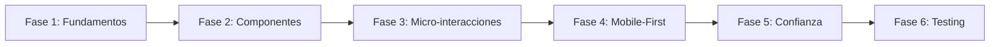

# ScooterCoop - Plan de Implementación UI/UX

## Visión General
Implementar la guía de diseño UI/UX existente para modernizar la plataforma de alquiler de scooters con enfoque en reducción de fricción y sensación de rapidez/sostenibilidad.

---

## Fase 1: Fundamentos del Diseño (Semana 1)

### 1.1 Sistema de Colores
- [ ] Actualizar `tailwind.config.mjs` con la paleta "Eco-Cyber"
- [ ] Crear variables CSS en `global.css`
- [ ] Verificar contrast ratios WCAG 4.5:1

### 1.2 Tipografía
- [ ] Importar JetBrains Mono y Space Grotesk
- [ ] Configurar escala tipográfica en Tailwind
- [ ] Establecer jerarquía de tamaños

### 1.3 Componentes Base
- [ ] Botones Primary/Secondary/Success con neón glow
- [ ] Tarjetas con bordes y efectos glassmorphism
- [ ] Inputs con estados de focus

---

## Fase 2: Componentes Críticos (Semana 2)

### 2.1 Hero Section
- [ ] Video loop 3s (720p WebM)
- [ ] Overlay gradiente oscuro
- [ ] CTA con animación bounce
- [ ] Stats CO2 en tiempo real

### 2.2 Tarjetas de Producto (Bento Grid)
- [ ] Layout Grid 2x2 para specs
- [ ] Indicador visual de batería
- [ ] Imagen 3D del scooter
- [ ] Precio destacado

### 2.3 Dashboard de Usuario
- [ ] Tarjetas de impacto CO2
- [ ] Historial de rutas
- [ ] Sistema de niveles/logros
- [ ] Progress bars animadas

---

## Fase 3: Micro-interacciones (Semana 3)

### 3.1 Mapa de Disponibilidad
- [ ] Animación pulse para scooters disponibles
- [ ] Animación breathing para ocupados
- [ ] Zoom al seleccionar
- [ ] Anillo de progreso

### 3.2 Proceso de Desbloqueo
- [ ] Fase 1: UI bounce (200ms)
- [ ] Fase 2: Blink cyan (300ms)
- [ ] Fase 3: Progress ring (1.5s)
- [ ] Sonido de chime

### 3.3 Transiciones de Pago
- [ ] Swipe effect al completar paso
- [ ] Fade in para nuevo paso
- [ ] Micro-copy dinámico

---

## Fase 4: Mobile-First (Semana 4)

### 4.1 Thumb Zone
- [ ] Botones navegación 48x48px
- [ ] Safe area inferior 20px
- [ ] Gesture de swipe (300ms delay)

### 4.2 Optimizaciones
- [ ] Touch targets mínimos 44px
- [ ] Espaciado entre elementos 8px
- [ ] Feedback visual en interacciones

---

## Fase 5: Pruebas Sociales y Confianza (Semana 5)

### 5.1 Mapa de Zonas
- [ ] Heatmap de demanda
- [ ] Indicadores de cobertura
- [ ] Búsqueda de zona específica

### 5.2 Reseñas
- [ ] Diseño de cards de reseñas
- [ ] Fotos de usuarios
- [ ] Rating visual con estrellas

---

## Fase 6: Accesibilidad y Testing (Semana 6)

### 6.1 WCAG 2.1 AA
- [ ] Verificar todos los ratios de contraste
- [ ] Implementar prefers-reduced-motion
- [ ] Testing con lectores de pantalla

### 6.2 Performance
- [ ] Optimizar animaciones (max 300ms)
- [ ] Lazy loading de componentes
- [ ] Lighthouse score > 90

---

## Diagrama de Flujo de Implementación

---

## Prioridades de Implementación

| Prioridad | Componente | Impacto |
|-----------|------------|---------|
| 🔴 Alta | Hero Section | Primera impresión |
| 🔴 Alta | Tarjetas Producto | Conversión |
| 🟡 Media | Dashboard | Retención |
| 🟡 Media | Micro-interacciones | UX |
| 🟢 Baja | Animaciones | Delight |

---

## Recursos Necesarios

- Video loop 3s para Hero
- Imágenes 3D de scooters
- Iconos para specs (velocidad, batería, etc.)
- Sistema de音效 para desbloqueo
- Datos para heatmap de zonas

---

*Documento creado: Marzo 2026*
*Versión: 1.0*
